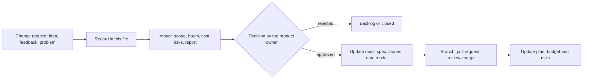

# Communications and changes

Version 1.0, Oct 28, 2026. Covers report element 18.

## 18.1 Communication plan

| What | Who | Channel | When |
|---|---|---|---|
| Progress against plan (self-review) | Author | These docs, [progress.md](progress.md) | Weekly; full review at the end of each phase |
| Change of every feature | Author (developer → reviewer) | GitHub pull request with description and preview | Per feature |
| Consultation and progress report | Author → supervisor | Practical classes and consultations | During the semester, as scheduled by the department |
| Coursework submission | Author → supervisor | Printed and electronic report | Before the final class |
| Defence | Author → supervisor and group | Presentation | Final class of the semester |
| Pilot organization | Author ↔ RS FIT | Meetings, messenger | From P4 (about Nov 24) to the tournament |
| Pilot users | Author ↔ players | Team invite links, a group chat, in-app feedback link (FR-36) | During the pilot, daily |
| Incidents | Author → affected users | Group chat | Within a day of a problem |

Principles: one source of truth (the repository); decisions are written down, not only discussed; stakeholders outside the project hear about changes that affect them.

## 18.2 Change management

### Process

Rules:

- Every change that affects scope, schedule, cost or the data model gets a record here
- New tables or columns are added only after the data model is updated
- Changes to MVP scope are checked against the report's success criteria; changes that affect the coursework are discussed with the supervisor
- Small UI polish inside an approved feature needs no record; the pull request is enough

### Change log

| ID | Date | Change | Reason | Impact | Decision |
|---|---|---|---|---|---|
| C1 | Requirements phase | Code written with an AI assistant (Next.js, Supabase) instead of no-code platforms | Row Level Security, custom rating and the character renderer are hard or impossible on no-code tools | Higher control and quality; review effort for the author | Approved |
| C2 | Requirements phase | GitHub and docs in the repository instead of Jira and Google Drive | One person; one source of truth next to the code | No cost; simpler | Approved |
| C3 | Requirements phase | MVP narrowed to P1 and P2: accounts, catalog, sessions, history, stats, rating, minimal teams | 5 months, one developer | Admin panel, seasons, custom dashboards, catalog moderation, comments and role distribution moved to the backlog or later phases | Approved |
| C4 | Requirements phase | Own online games (no multiplayer → multiplayer → ranked) out of scope | Too large for the project | Concept goal 5 not pursued in this project | Approved |
| C5 | Requirements phase | Session place and duration fields not in the MVP; note field kept | Logging must take under 1 minute | Fewer fields in the log flow | Approved |
| C6 | Requirements phase | Admin panel replaced by the maintainer editing catalog and achievements through migrations | Saves P4 time | No admin UI | Approved |
| C7 | Oct 25, 2026 | "Groups" renamed to "teams" | Clearer for users | Migration and UI rename | Approved |
| C8 | Oct 25, 2026 | Catalog reduced to 3 games (Chess, Yahtzee, Codenames), with their sessions removed | Author's request to clean test data | Conflicts with the 30-game requirement (FR-06); risk R5 occurred | Approved; refill planned before the pilot |
| C9 | Oct 25, 2026 | P3 work (30 achievements, character) pulled ahead before P2 was complete | Motivation and demo value | P1 and P2 gaps remain open (see [progress.md](progress.md)) | Approved; gaps first from now on |
| C10 | Oct 27, 2026 | Simple blob characters replaced by layered fantasy characters: 5 races, hair, beards, eye colour, 10 free outfits | Product feel: the blobs did not look like a game | About 2 days of work; new art pipeline scripts | Approved |
| C11 | Oct 27, 2026 | Game-style customizer: character on the left, tabs, camera zoom, dice, animations; accessories and badges hidden until they have art | Usability and uniqueness | Accessory art moved to the backlog | Approved |
| C12 | Oct 28, 2026 | Project management docs added in `docs/project/` | Coursework report needs the 20 PM elements | About 4 h | Approved |
| C13 | Oct 28, 2026 | Stage 1 of own games brought into scope: Games tab split into Play and Track; Yahtzee playable on one device (FR-43, FR-44) | Author's product decision: playing, not only tracking, makes the app a destination | Reverses part of C4. No new tables: a game is saved as a normal points session. Network multiplayer stays out of scope | Approved |
| C14 | Oct 28, 2026 | Yahtzee modes: Solo, With friends on one phone, and Invite friends as a "Coming soon" placeholder. Results of in-app games are no longer saved to history or ratings (FR-45, FR-46 to the backlog) | Author's decision: play first, rating integration later | Smaller scope; no effect on ratings | Approved |
| C15 | Oct 28, 2026 | Admin panel for super admins: overview, catalog, players with blocking (FR-47). New column `profiles.is_super_admin` and table `admin_audit` | Catalog refill and pilot monitoring without migrations; pilot numbers before PostHog | Reverses C6. Profiles now limit which columns players may update | Approved |
| C16 | Oct 28, 2026 | All UI text in lowercase, page titles and the brand included. Only text players typed keeps its case: nicknames, guest and team names, custom game names, emails | Author's design decision: a softer, more casual voice | One global style plus marking of player-typed text; no data changes | Approved |
| C17 | Oct 28, 2026 | Session confirmation by squad leaders (FR-40, FR-41) replaced by team management modes: owner-managed or team-managed, a setting for who can log, and approvals by the players of a session (FR-48 to FR-50) | Author's product decision: simpler for friend groups, no squads needed to confirm results | Moves confirmation from the backlog to P4; needs a migration with team settings, a pending status and approvals | Approved |
| C19 | Oct 29, 2026 | Blackjack added to Play (FR-51), with a playing card component and the game setup screens shared between games | Author's product decision: a second in-app game, the first with cards | No new tables or dependencies; chips are local to the game and not saved | Approved |
| C20 | Oct 29, 2026 | Redesign: every top page shows its name as the title instead of a poster. Home gets a character card, rating, win streak, activity calendar, last sessions, rivals from shared sessions and play now. Profile becomes a gear stage: the character with six gear slots (hat, earrings, amulet, gloves, ring, weapon) and a panel that switches between gear and the look editor; achievements in one row; rating chart and stats by game. Gear is a mock: no tables, all items locked | Author's product decision: more game-like pages, fewer boxes | No new tables or dependencies. Gear needs a data model before it can be real. The customize page now opens the look on the profile | Approved |
| C21 | Oct 29, 2026 | Redesign fixes: the character is a trading card on Home and Profile; a narrower profile card; profile numbers under the gear panel; tooltips drawn over the page; a second display font (Uncial Antiqua, replaces the unused Cinzel); Home rating is the average over all games; activity shows the date and sessions on hover; last sessions open in history highlighted; chips kept only for tags; Games has play, catalog (renamed from track) and log blocks | Author review of C20 | No new tables or dependencies. The font loads through next/font like the first one | Approved |
| C18 | Oct 28, 2026 | Sessions are managed only in their panel: the team page, or a new personal panel for sessions without a team. Profile history becomes read-only with the team of each session. Sessions never move between teams | Author's decision: one clear place to manage each session, ready for team management modes | Edit and delete leave the history page; a guard in `update_session` keeps the team | Approved |
| C22 | Oct 31, 2026 | Stage 2 of own games: online Yahtzee by invite (FR-45). A player invites teammates, they see the invite in the app, and everyone plays from their own device, desktop or phone, in one synchronized game. The server is the authority: it rolls the dice, checks turns and applies the rules. New tables `game_rooms` and `game_room_players`; sync through Supabase Realtime. Invites expire after 15 minutes or when cancelled; each turn has a limit per game (60 seconds by default), then a second timer with wait or remove for the host, then an automatic skip by the game's rule. The host's own turn gets a third 60-second timer, then the game is dismissed. A game that ends early (dismissed, or one player left) records no winner | Author's product decision: playing together from separate devices; the base for store apps and saved in-app results later | Partly reverses C4 and C13. About 3 to 4 days. No new dependency (Realtime is part of Supabase). Server routes accept a login token so future native apps can use them. Ranked play, push notifications and native apps stay out of scope | Approved |
| C23 | Oct 31, 2026 | Rating rules: sessions with at least one guest are kept in history, marked, but not rated; guests have no ratings; a linked guest shows the account name with a guest mark and old sessions are not re-rated. Leaderboards rank by Elo, overall by a weighted average of game ratings; wins and games played are extra columns. Luck-heavy games keep the general Elo for now; per-game tuning later | Author's decision: ratings only between registered players; Elo as the main system | Reverses the guest rule of docs/rating.md. Rating columns for guests are no longer used. All ratings are rebuilt once without sessions with a guest. Those sessions still count toward games played, wins, win rate and achievements | Approved |
| C24 | Oct 31, 2026 | Deleting guests (FR-53) and custom games (FR-54): by the creator or by a team owner. History keeps the sessions; a deleted custom game loses its ratings and stats; earned achievements stay | Author's decision: owners keep their teams tidy | New columns `guests.deleted_at` and `games.deleted_at` (hidden, not removed, so history stays) | Approved |
| C25 | Oct 31, 2026 | Time zone per profile (FR-55); days for streaks, activity and achievements use the local day | Players are in different time zones | New column `profiles.time_zone` | Approved |
| C26 | Oct 31, 2026 | Team ownership transfer (FR-52), so an owner can leave | Answer to the open owner-leaves rule of US-G3 | New server function, no new tables | Approved |
| C27 | Oct 31, 2026 | Approvals (FR-50): automatic confirmation after 48 hours, shown on the session; sessions with a guest need no approval. FR-42 merged into FR-50 | Author's decision on the open questions of FR-42 | No extra tables beyond the approvals design | Approved |
| C28 | Oct 31, 2026 | Privacy and catalog: account deletion (FR-05) becomes Must; email verification required; privacy policy before public launch; game type `dominoes` renamed to `tile` | Users may be in the US, the EU and elsewhere; clearer type name | A migration for the type rename; a privacy policy text before launch | Approved |

Example in detail (C10): the first character was a simple coloured blob. During P3 the author decided it did not feel like a game. Impact assessment: about 2 days of work, no extra cash (art generated with existing AI tools), no data model change beyond the character's saved choices. Decision: approved, because the character is the main motivation feature. Result: a layered art pipeline, 5 races and 10 outfits, merged in PRs #30 to #34.
