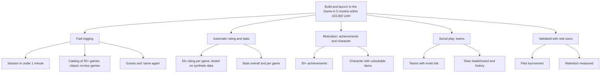

# Project charter: In the Game

Version 1.0, Oct 28, 2026. Based on the approved concept ([source/concept-uk.md](source/concept-uk.md), Task 1). Scope changes made since the concept are in [changes.md](changes.md).

Covers report elements 1 to 5, 7 and 8. Section numbers match the element numbers of the report; element 6 is in [structure.md](structure.md).

## 1. Project and its environment

### 1.1 Summary and project type

In the Game is a web platform for logging board and card game sessions. Any session, even a casual card game in a kitchen, becomes a record in the player's history. From that history the platform builds statistics, ratings, rivalries, achievements and a customizable character. The product sells interest in one's own history of wins, not bookkeeping.

| Classification | Type |
|---|---|
| By purpose | IT product development (web application) |
| By scale | Small: one developer, 440 person-hours, 103,000 UAH notional budget |
| By complexity | Medium: standard web stack, plus a rating algorithm, row-level data security and a layered character art pipeline |
| By duration | Short-term: 5 months (Sep 15, 2026 to mid-February 2027, with the planned work finishing Dec 28, 2026) |
| By domain | Social and leisure, gamification |
| By customer | Initiative project of the author, carried out as university coursework |
| By result | Product project with an innovative component (gamified history of offline play) |

### 1.2 External environment

| Factor | Description | Effect on the project |
|---|---|---|
| Technological | Mature serverless platforms (Supabase, Vercel) with free tiers; AI coding assistants (Claude Code) and image models (ChatGPT) | One person can build a full product; art is produced with AI and processed by scripts |
| Economic | No budget beyond the author's own funds; free tiers for up to about 50 users | Notional labour cost; stay on free tiers, keep the move to paid tiers possible without code changes |
| Social | Board game nights among students, friends and clubs are common; interest in personal stats ("Wrapped"-style summaries) | Mobile-first, fast logging, visual stats and achievements |
| Competitive | Existing apps for logging plays (for example BG Stats, BoardGameGeek play logging) focus on collectors and bookkeeping | Focus on what they lack: zero-setup classic games, team rivalry, a character that grows with wins, free of charge |
| Legal | Personal data of users (email, nickname); users may be in the EU | Minimal data, Row Level Security on every table, account deletion, privacy policy before public launch (users in the US, the EU and elsewhere; change C28) |
| Organizational | The project is coursework at NTU "Dnipro Polytechnic", FIT; one developer during a semester | Fixed defence date at the final class; documentation must map to the 20 report elements |

## 2. Systems view of the real-world object

### 2.1 Origin of the idea

The author and friends play board and card games regularly, but results disappear the moment the game ends. Nobody remembers who won most often, who is the best at a given game, or how a rivalry developed. Existing apps are built for collectors and take too long to fill in. The idea: make logging faster than the game's own clean-up, and give the player something back for every logged session (rating, stats, achievements, character).

The real-world object is a game night: players, a game, a result. The system turns it into data: a session with participants and results, from which ratings and stats are derived.

### 2.2 Stakeholders and integration

| Stakeholder | Interest | Influence | How they are involved |
|---|---|---|---|
| Players, friends | Fast logging, stats, fun | High | End users; pilot participants; feedback |
| Organizers of game nights | History and leaderboards of their group | Medium | Create teams, log sessions for everyone |
| Game clubs | Engagement of their members | Low now, high later | Potential partners for the pilot and promotion (barter) |
| Project author | Working product, passing the course | High | Product owner, manager, analyst, designer, developer, tester |
| University supervisor (Dept. of System Analysis and Management) | Complete coursework covering 20 PM elements | High | Consultations, review, final assessment |
| Student council of FIT (RS FIT) | Student activities | Medium | Room, promotion, prize fund, players for the pilot |
| Hosting providers (Supabase, Vercel, GitHub) | Usage of their platforms | Medium | Infrastructure on free tiers |
| Competitors | Market position | Low | Shape user expectations |

Integration examples:

- Supabase Auth for email registration and password reset; Supabase PostgreSQL with Row Level Security as the database
- Vercel builds a preview for every pull request and deploys `main` to production
- GitHub hosts the code, pull requests and review; Supabase applies migrations on merge
- Invite links let a team grow through messengers without any integration
- Planned: PostHog for retention analytics, Sentry for errors

## 3. Product of the project

### 3.1 Product description

A responsive web application (mobile first) with:

- Accounts: email registration, login, password reset, profile with nickname and character
- Guest profiles: players without an account, created by a name
- Game catalog: search and filters by type and player count; classic games that need no box; custom games
- Session logging: game, participants, result as winner, places or points; "same again" for the last line-up; target under 1 minute
- History: paginated list with filters; delete own sessions
- Rating and statistics: Elo-style rating per player per game, monthly stats, team leaderboards
- Teams: create, invite by link, join, leave, team history and stats
- Achievements: 30 achievements awarded automatically, with progress
- Character: 5 races, skin, hair, beard, eye colour, 10 outfits, backgrounds; game-style customizer
- Documentation: specification, user stories, data model, rating, achievements, character, project management docs

Detailed requirements: [../spec.md](../spec.md) and [../user-stories.md](../user-stories.md).

### 3.2 Product and stages

| Stage | Product increment |
|---|---|
| Initiation | Concept, charter |
| Requirements | Specification, user stories, data model, rating algorithm |
| P1 | Accounts, guests, catalog, session logging, history |
| P2 | Rating, statistics, minimal teams |
| P3 | Achievements, character customization, profile |
| P4 | Team management, feed, table tools |
| Pilot | Production release, test tournament, fixes |
| Final | Final report, improvement backlog |

## 4. Goal and strategy

### 4.1 Goal tree

### 4.2 Alternative strategies

| Strategy | Pros | Cons | Decision |
|---|---|---|---|
| No-code platform (as in the concept) | Fast start, no programming | Hard to get Row Level Security, custom rating logic and a custom character renderer; vendor lock-in | Rejected during requirements |
| Own code with an AI coding assistant (Next.js + Supabase) | Full control, standard PostgreSQL, free tiers, testable logic | Needs review of every change by the author | **Chosen** |
| Narrow niche: one game type only (for example only card games) | Simpler | Small audience, loses "any game" value | Rejected |
| Mobile app instead of web | Native feel | Store publishing, two platforms, longer | Rejected; responsive web instead |

## 5. Success criteria and measures

### 5.1 Criteria

The project succeeds if by the end of the pilot:

- The MVP (phases P1 and P2) works in production and passes its acceptance criteria
- Session entry takes under 1 minute on average, measured on real users
- The catalog has at least 30 games, and at least 30 achievements exist
- The rating is confirmed correct by tests on synthetic data
- The pilot tournament is held with sessions logged through the app
- Cost stays within 103,000 UAH (notional) and the report is defended on time

It fails if the MVP is not in production by the pilot, or the pilot cannot be held.

Constraints: one developer; 440 person-hours; free tiers; English interface; no monetization.

### 5.2 Measures

| Measure | Target | How it is measured |
|---|---|---|
| Session entry time | Under 60 seconds on average | Timing pilot users; PostHog event timing (planned) |
| Active users | 20 to 50 in the pilot; 50 in the first quarter | Supabase data, PostHog |
| Logged sessions | 300 in the first quarter | Count of sessions |
| Retention at month two | At least 40% | PostHog cohorts |
| Catalog size | At least 30 games | Count of catalog games |
| Achievements | At least 30 | Achievement catalog (30 now) |
| Rating correctness | All test cases pass | Vitest suite (100 tests pass now) |
| Cost performance | CPI ≥ 1 | Earned value report ([budget.md](budget.md)) |
| Schedule performance | SPI ≥ 1 | Earned value report |

## 7. Project analysis and funding

Covers report element 7.

| Analysis | Summary |
|---|---|
| Market | Target: students, friend groups, clubs; start with 20 to 50 users. Competitors serve collectors |
| Technical | Standard stack on free tiers; rating as pure functions with tests; risks: free-tier limits, AI art quality |
| Financial | 103,000 UAH notional; real cash spend about 15,000 UAH (see [budget.md](budget.md)); no revenue planned |
| Social | Builds a community around game nights at FIT |
| Risk | Register in [risks.md](risks.md) |
| SWOT | Strengths: speed of logging, gamification, free. Weaknesses: one developer, small audience. Opportunities: clubs, tournaments, students. Threats: competitors, low habit of logging |

Funding sources:

- The author's own funds (main source): subscriptions, domain
- Resource support from RS FIT: room, promotion, prize fund, players
- Partnership with city game clubs on a barter basis
- Grant programs for student start-ups (not applied for yet)

## 8. Project start and legal form

### 8.1 Base document

This charter, together with the concept (Task 1), formalizes the start of the project. It records the goal, scope, stakeholders, budget, schedule and the author's authority as project manager and product owner. Approval: the author (product owner) and review by the university supervisor.

### 8.2 Legal form and milestones

No legal entity is created during development. The project runs as student coursework and the author's personal project. If it continues as a public service, the expected form is a sole proprietor (ФОП), which needs a privacy policy and terms of use before launch.

| Milestone | Planned | Actual |
|---|---|---|
| M0 Charter approved | Sep 28, 2026 | Concept done; date to confirm |
| M1 Specification and prototype approved | Oct 12, 2026 | Spec, stories, data model and rating docs merged Oct 24, 2026; the prototype was built in code |
| M2 P1: session logging, catalog started | Oct 26, 2026 | Mostly reached Oct 25, 2026 (gaps in [progress.md](progress.md)) |
| M3 P2: rating, stats, minimal teams | Nov 9, 2026 | In progress (rating and teams done Oct 25) |
| M4 P3: customization and profile | Nov 23, 2026 | Largely done ahead of plan (Oct 25 to 27) |
| M5 P4: team management, feed, table tools | Dec 7, 2026 | Not started |
| M6 Pilot: test tournament | Dec 21, 2026 | Not started |
| M7 Final report and defence | Dec 28, 2026 (defence at the final class) | Not started |
