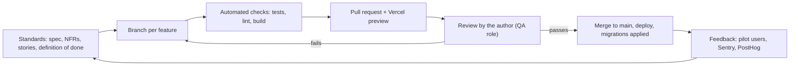

# Quality management and acceptance

Version 1.0, Oct 28, 2026. Covers report elements 16 and 19.

## 16. Quality management

### 16.1 Quality actions

| Process | What is done | Evidence |
|---|---|---|
| Quality planning | Quality targets set in the spec: non-functional requirements NFR-01 to NFR-09 (speed, security, privacy, compatibility, cost, maintainability, data integrity, accessibility); acceptance criteria for every user story; definition of done | [../spec.md](../spec.md) section 6, [../user-stories.md](../user-stories.md) |
| Quality assurance | Rules that prevent defects: one feature per branch; no direct commits to main; schema only through migrations; Row Level Security on every table; rating and stats as pure functions with tests; no secrets in the repository; the AI assistant must propose a plan before non-trivial changes | CLAUDE.md, git history |
| Quality control | Checks that find defects: unit tests (Vitest), lint (ESLint), production build, review of every pull request by the author, check of the Vercel preview at phone and desktop width, visual checks of character art | 100 tests pass (Oct 28, 2026); 34 merged pull requests |

Definition of done for a feature:

- Merged to main through a pull request after review
- Rating and statistics logic has tests
- New tables have Row Level Security policies
- Works at mobile width
- The acceptance criteria of the story are checked
- Documentation updated when behaviour changes

### 16.2 Quality management system

| Function | Tool | Status |
|---|---|---|
| Version control and review | GitHub pull requests | In use |
| Automated tests | Vitest: rating, statistics, achievements, character | In use (8 test files, 100 tests) |
| Static checks | ESLint | In use |
| Preview environment | Vercel preview per pull request | In use |
| Database safety | Migrations in `supabase/migrations/`, Row Level Security | In use |
| Continuous integration | GitHub Actions running lint and tests (NFR-07) | **Not set up yet** |
| Error monitoring | Sentry (FR-35) | Planned for the pilot |
| Product analytics | PostHog (FR-34): registration, session created, return visits | Planned for the pilot |
| Documentation | `docs/` in the repository | In use |

## 19. Acceptance of the product

### 19.1 Actions

1. Check every Must and Should requirement of the MVP against its acceptance criteria (status table in [progress.md](progress.md))
2. Run the automated checks: tests, lint and production build pass on main
3. Verify the rating on synthetic data (test plan in [../rating.md](../rating.md) section 8)
4. Check security: every table has Row Level Security; a second account cannot read or change another player's data
5. Measure session entry time on real users during the pilot (target under 1 minute)
6. Collect pilot feedback and fix blocking issues
7. Final acceptance by the product owner; assessment by the supervisor at the defence

### 19.2 Procedure

| Step | Who | Input | Output | Pass condition |
|---|---|---|---|---|
| 1 Feature acceptance | Author (product owner) | Pull request, preview | Merged feature | Definition of done met |
| 2 Phase acceptance | Author | All features of the phase | Phase marked done in [progress.md](progress.md) | All Must stories of the phase accepted |
| 3 Pilot acceptance test | Author, pilot players | Production app, tournament | Timing results, feedback list | Average entry under 60 s; no blocking defects |
| 4 Project acceptance | Author, supervisor | Product, final report | Defended coursework | Success criteria in [charter.md](charter.md) section 5 met or explained |

Acceptance record format (one row per feature or phase):

| Date | Item | Criteria checked | Result | Notes |
|---|---|---|---|---|
| Oct 25, 2026 | Session logging (US-C1, US-C2) | Three result types, guests, "same again" | Accepted | Timing to be measured in the pilot |
| Oct 27, 2026 | Character customizer (US-F1) | Several options, saved, visible on profile | Accepted | Accessory art deferred |
