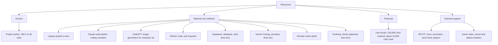
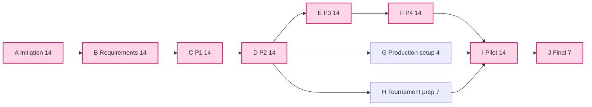
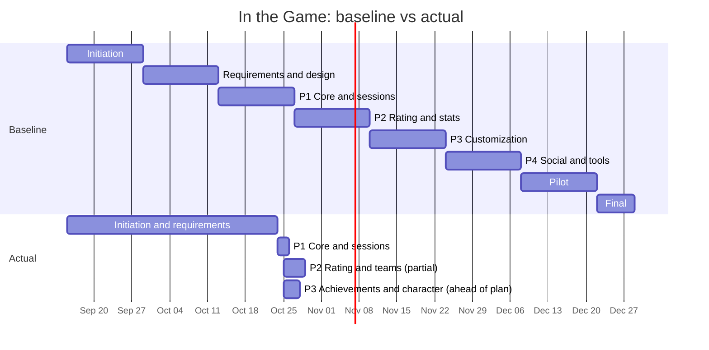

# Resources and schedule

Version 1.0, Oct 28, 2026. Covers report elements 12 and 13.

## 12. Resource management

### 12.1 Resources and resource breakdown structure (RBS)

Assignment of resources to work packages (WBS codes from [structure.md](structure.md)):

| Work package | Human | Material and software | External |
|---|---|---|---|
| 1 Initiation | Author 30 h | Laptop | |
| 2 Requirements and design | Author 50 h | Laptop, Claude | |
| 3 P1 Core and sessions | Author 60 h | Claude, GitHub, Supabase, Vercel | |
| 4 P2 Rating and stats | Author 60 h | Claude, GitHub, Supabase, Vercel | |
| 5 P3 Customization and profile | Author 60 h | Claude, ChatGPT, Python scripts, GitHub, Vercel | |
| 6 P4 Social and tools | Author 70 h | Claude, GitHub, Supabase, Vercel | |
| 7 Pilot | Author 60 h | Domain, PostHog, Sentry, promotion budget | RS FIT, game clubs, pilot players |
| 8 Final | Author 30 h | Laptop | Supervisor |
| 9 Project management | Author 20 h | GitHub | |

### 12.2 Consumption limits

| Resource | Limit | Control |
|---|---|---|
| Author's time | 440 h in total; about 30 h per week during the semester | Hours log in [budget.md](budget.md); weekly review |
| Hours per phase | As in the WBS; an overrun above 20% of a phase needs a decision (cut scope or use reserve time) | Earned value report |
| Claude subscription | 1,000 UAH per month, 5 months | Fixed monthly cost |
| Promotion | 5,000 UAH, only during the pilot | Spent after the production release |
| Prize fund | 1,000 UAH, only at the tournament | RS FIT may cover it |
| Reserve | 3,000 UAH; used only by a recorded decision in [changes.md](changes.md) | Change log |
| Free tiers (Supabase, Vercel, PostHog, Sentry) | Stay within the free limits for up to 50 users. Exact limits must be checked on the service websites; they are not verified here | Pagination, indexes, no polling; dashboard checks during the pilot |

## 13. Time management

### 13.1 Tools

- Gantt chart (below) for the baseline and the actual dates
- Network diagram and critical path method (CPM) to find the activities that set the end date
- Phases of two weeks with a review at the end of each; a weekly check of progress against the plan
- Git history (commit and merge dates) as the record of actual dates
- The concept planned Jira for the schedule; the project uses these docs and GitHub instead (change C2 in [changes.md](changes.md))

### 13.2 Network diagram and critical path

Day 0 is Sep 15, 2026. Durations are calendar days.

| ID | Activity | Duration | Predecessors | ES | EF | LS | LF | Float |
|---|---|---:|---|---:|---:|---:|---:|---:|
| A | Initiation | 14 | | 0 | 14 | 0 | 14 | 0 |
| B | Requirements and design | 14 | A | 14 | 28 | 14 | 28 | 0 |
| C | P1 Core and sessions | 14 | B | 28 | 42 | 28 | 42 | 0 |
| D | P2 Rating and stats (MVP) | 14 | C | 42 | 56 | 42 | 56 | 0 |
| E | P3 Customization and profile | 14 | D | 56 | 70 | 56 | 70 | 0 |
| F | P4 Social and tools | 14 | E | 70 | 84 | 70 | 84 | 0 |
| G | Production setup: domain, analytics, monitoring | 4 | D | 56 | 60 | 80 | 84 | 24 |
| H | Tournament preparation with RS FIT | 7 | D | 56 | 63 | 77 | 84 | 21 |
| I | Pilot: tournament and fixes | 14 | F, G, H | 84 | 98 | 84 | 98 | 0 |
| J | Final report and defence | 7 | I | 98 | 105 | 98 | 105 | 0 |

**Critical path: A → B → C → D → E → F → I → J, 105 days (15 weeks), from Sep 15 to Dec 28, 2026.** With one developer, all development phases are on the critical path; only production setup (G) and tournament preparation (H) have float, because RS FIT can prepare the tournament in parallel. The concept's 5 months leave a reserve until mid-February 2027.

### 13.3 Gantt chart: baseline and actual

Schedule notes (status Oct 28, 2026):

- Development started 11 days after the planned P1 start (first commit Oct 24 instead of Oct 13), because requirements took longer
- With the AI coding assistant, P1 and most of P2 and P3 were built in four days (Oct 24 to 27), so the project is ahead of plan in delivered work. See the earned value report in [budget.md](budget.md)
- Phase order changed: P3 (achievements and character) was pulled ahead before P2 was complete. The P1 and P2 gaps are listed in [progress.md](progress.md)
