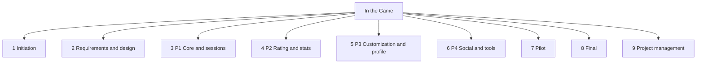
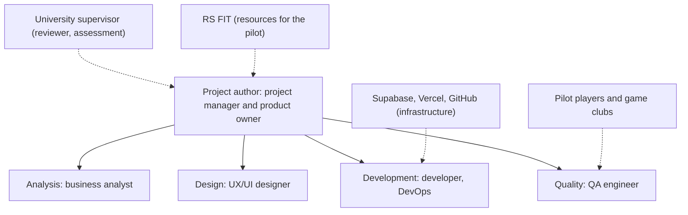

# Life cycle, organization and work structure

Version 1.0, Oct 28, 2026. Covers report elements 6, 9, 10 and 11.

## 6. Life cycle

### 6.1 Life cycle model

The project uses a staged life cycle with iterative development inside it:

- Initiation and requirements are sequential: each ends with an approved document
- Development runs in four two-week iterations (P1 to P4), Scrum-style. Each iteration ends with a working increment in production
- Inside an iteration, work flows as a Kanban of small features: one feature, one branch, one pull request, reviewed and merged by the author, deployed by Vercel
- The pilot validates the product with real users; the final stage closes the project

The product life cycle continues after the project: the improvement backlog (spec section 4.9) is the input for the next projects.

### 6.2 Phases

| Phase | Dates (plan) | Inputs | Key work | Output (gate) |
|---|---|---|---|---|
| Initiation | Sep 15 to Sep 28, 2026 | Idea | Concept, audience, stakeholders, charter | Charter approved |
| Requirements and design | Sep 29 to Oct 12 | Charter | Spec, user stories, data model, rating algorithm, prototype | Spec and prototype approved |
| P1 Core and sessions | Oct 13 to Oct 26 | Spec | Accounts, guests, catalog, session logging, history | Session logging in production |
| P2 Rating and stats | Oct 27 to Nov 9 | P1 | Rating, stats, charts, minimal teams | MVP complete |
| P3 Customization and profile | Nov 10 to Nov 23 | P2 | Achievements, character, profile | Profile and character |
| P4 Social and tools | Nov 24 to Dec 7 | P3 | Team roles, feed, table tools | Full feature set |
| Pilot | Dec 8 to Dec 21 | P4 | Domain, production checks, tournament, fixes | Tournament held |
| Final | Dec 22 to Dec 28 | Pilot data | Final report, backlog, defence | Report defended |
| Reserve | Dec 29, 2026 to Feb 15, 2027 | | Buffer within the 5 months of the concept | |

Actual progress per phase: [progress.md](progress.md).

## 9. Project organization and team

### 9.1 Organizational structure

Type: **project (projectized) structure**. The author is the only team member and has full authority over scope, schedule and resources; there is no functional organization to share people with. The university supervisor and RS FIT are outside the project and act as reviewer and resource supporter.

Why: one person, a fixed short deadline and a single product. A functional or matrix structure would add coordination with nobody to coordinate.

### 9.2 Team

The author combines every role. Principle: one person, many hats, with a clear rule for each hat so that quality checks are not skipped.

| Role | Responsibilities | Rule that keeps it honest |
|---|---|---|
| Project manager | Plan, schedule, budget, risks, reports | Weekly review of progress against the plan |
| Product owner | Priorities, acceptance of features | Accepts a feature only against its user story |
| Business analyst | Spec, user stories, data model | Requirements written before building |
| UX/UI designer | Prototype, visual style, character art direction | Mobile-first check of every screen |
| Developer | Code, migrations, scripts | One feature per branch, no direct commits to main |
| QA engineer | Tests, review, preview checks | Tests for rating and stats; check on the Vercel preview before merging |
| DevOps | Supabase, Vercel, GitHub | Schema only through migrations; secrets never committed |

## 10. Work breakdown structure

### 10.1 Principle

The WBS is built by **life cycle phase first, then by deliverable**. The phases match the milestones of the concept, so progress and earned value can be reported per phase. Inside the development phases the work packages are product modules, which are also the units of review (pull requests).

### 10.2 WBS

Planned effort per work package (total 440 person-hours, see [budget.md](budget.md)).

| Code | Work package | Hours |
|---|---|---:|
| 1 | **Initiation** | **30** |
| 1.1 | Idea and audience analysis | 8 |
| 1.2 | Competitor review | 6 |
| 1.3 | Concept and charter | 16 |
| 2 | **Requirements and design** | **50** |
| 2.1 | Technical specification | 14 |
| 2.2 | User stories with acceptance criteria | 10 |
| 2.3 | Data model and access rules | 10 |
| 2.4 | Rating algorithm and test cases | 8 |
| 2.5 | UX prototype and visual style | 8 |
| 3 | **P1 Core and sessions** | **60** |
| 3.1 | Project setup, database schema, security policies | 12 |
| 3.2 | Accounts and profile | 10 |
| 3.3 | Game catalog | 12 |
| 3.4 | Session logging flow | 18 |
| 3.5 | History | 8 |
| 4 | **P2 Rating and stats** | **60** |
| 4.1 | Rating engine and tests | 16 |
| 4.2 | Personal statistics and charts | 16 |
| 4.3 | Minimal teams | 18 |
| 4.4 | Team leaderboards and history | 10 |
| 5 | **P3 Customization and profile** | **60** |
| 5.1 | Achievements | 20 |
| 5.2 | Character art and renderer | 28 |
| 5.3 | Customizer and profile | 12 |
| 6 | **P4 Social and tools** | **70** |
| 6.1 | Team roles and management | 12 |
| 6.2 | Social feed | 22 |
| 6.3 | Table tools: scoreboard, timers, dice, team generator | 36 |
| 7 | **Pilot** | **60** |
| 7.1 | Domain, production setup, analytics and monitoring | 14 |
| 7.2 | Tournament preparation and seed data | 12 |
| 7.3 | Tournament and support | 14 |
| 7.4 | Fixes after feedback | 20 |
| 8 | **Final** | **30** |
| 8.1 | Final report | 20 |
| 8.2 | Improvement backlog and defence | 10 |
| 9 | **Project management** (throughout) | **20** |
| | **Total** | **440** |

Value for the project: every package has an owner role, an estimate and a deliverable, so the schedule, budget and earned value are all built on the same list.

## 11. Organizational structure and responsibility

### 11.1 OBS

Value: it shows which hat is responsible for each part of the work, and who outside the project supports or reviews it.

### 11.2 Responsibility matrix (RACI)

R: responsible, A: accountable, C: consulted, I: informed. "Author" covers all internal roles.

| Work package | Author | Supervisor | RS FIT | Pilot players | Game clubs |
|---|---|---|---|---|---|
| 1 Initiation | R, A | C | I | C | I |
| 2 Requirements and design | R, A | C | | C | |
| 3 P1 Core and sessions | R, A | I | | | |
| 4 P2 Rating and stats | R, A | I | | | |
| 5 P3 Customization and profile | R, A | I | | C | |
| 6 P4 Social and tools | R, A | I | | C | |
| 7 Pilot | R, A | I | R (room, promo, prizes) | R (play, feedback) | C |
| 8 Final report and defence | R, A | C (assessment) | I | I | I |
| 9 Project management | R, A | C | | | |

Value: with a single person doing the work, the matrix mainly shows where outside people must be consulted or informed, and where the pilot depends on them.
